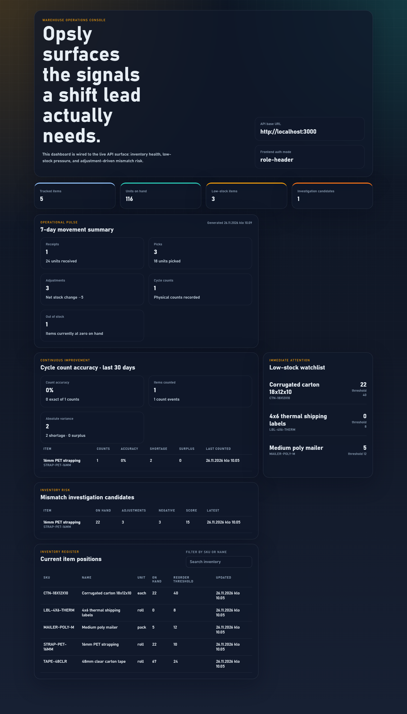
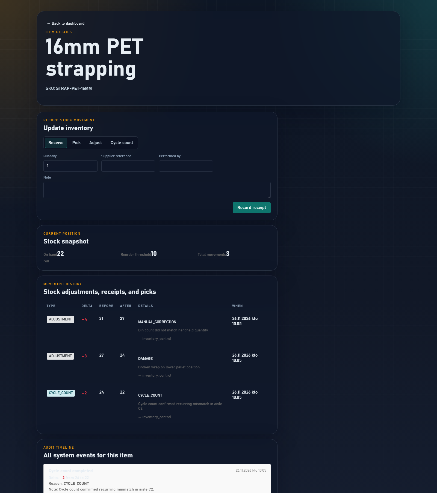

# Opsly

Opsly is a warehouse inventory app. It helps a team see stock, record stock changes, and review item history. It has a web app, an API, and shared data types.

## What it does

- Shows inventory, low-stock items, and recent activity.
- Records receipts, picks, and stock adjustments from an item page.
- Records physical cycle counts and reports count accuracy, shortages, and surplus by item.
- Shows an item's movement and audit history.
- Highlights items that may need an inventory investigation.

## Current scope

Stock is tracked as one aggregate balance per item, not by warehouse location or bin. The current
app does not model multiple warehouses, customer-specific WMS configuration, or external system
integrations. Location/bin-level inventory is the next major domain step.

The admin report `GET /reports/cycle-count-accuracy?periodDays=30` measures the share of physical
counts that exactly matched the recorded quantity. It uses explicit cycle-count events, not ordinary
adjustments; historical counts recorded before this event type was introduced cannot be
distinguished from generic adjustments and are not included. Accuracy is unavailable until at least
one count is recorded in the reporting period. PostgreSQL calculates the report aggregates in SQL;
the in-memory backend uses the same metric definitions.

Use the report to spot repeated count variances and prioritize follow-up on items with shortages or
surplus. It is an operational signal, not a root-cause analysis or an inventory valuation.

Cycle-count stock updates and movement records are currently separate writes, without a PostgreSQL
transaction or row-level locking. A failed movement insert or concurrent stock change could leave
the on-hand balance and count history out of sync; this demo is not ready for concurrent production
inventory workflows.

Item movement history, audit history, and operational reports require the admin role because
movement details can contain operator names and operational notes. Item and low-stock reads remain
available to viewers.

## Demo screenshots

These screenshots use fictional data loaded by the local demo seed.





## Run locally

You need Node.js 22 and pnpm 10. From the project folder, install dependencies and copy the example environment files:

```powershell
pnpm install
if (-not (Test-Path apps/api/.env)) {
  Copy-Item apps/api/.env.example apps/api/.env
}
if (-not (Test-Path apps/web/.env)) {
  Copy-Item apps/web/.env.example apps/web/.env
}
```

For a local demo, set these values in `apps/api/.env`:

```text
OPSLY_ALLOWED_ORIGINS=http://localhost:5173,http://localhost:5174
OPSLY_AUTH_MODE=role-header
OPSLY_SEED_DEMO_DATA=true
```

In `apps/web/.env`, set:

```text
VITE_API_BASE_URL=http://localhost:3000
VITE_API_ROLE=admin
```

Start both apps:

```powershell
pnpm dev
```

Open [http://localhost:5173](http://localhost:5173). Role-header authentication is for local demos only; the API uses bearer tokens by default.

## Data storage

The app uses temporary in-memory storage by default, so data resets when the API restarts. To use PostgreSQL, start a local PostgreSQL server and set `OPSLY_DATA_BACKEND=postgres` and `DATABASE_URL` in `apps/api/.env`.

## Checks

Run this before sharing a change:

```powershell
pnpm check
```

It checks types, lint, formatting, builds, and API tests.

## Project folders

- `apps/api` - API and inventory rules
- `apps/web` - browser app
- `packages/shared` - types used by both apps

The next major inventory step is tracking stock by location and bin.
